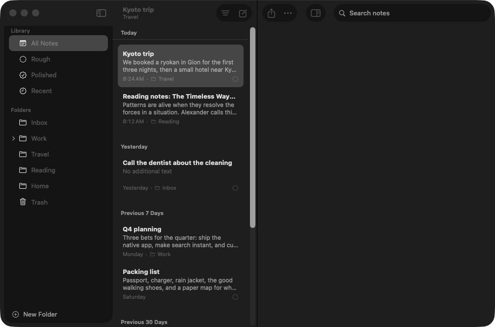
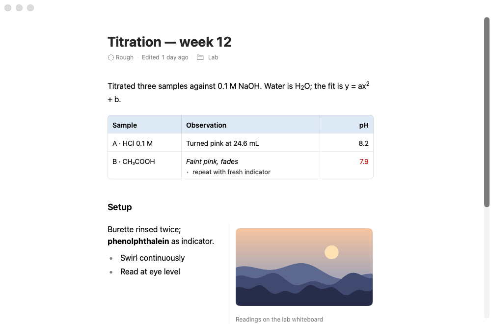
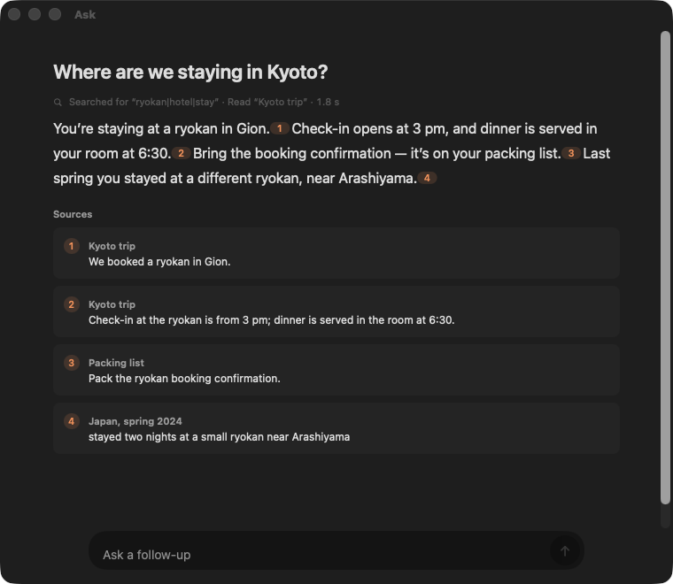
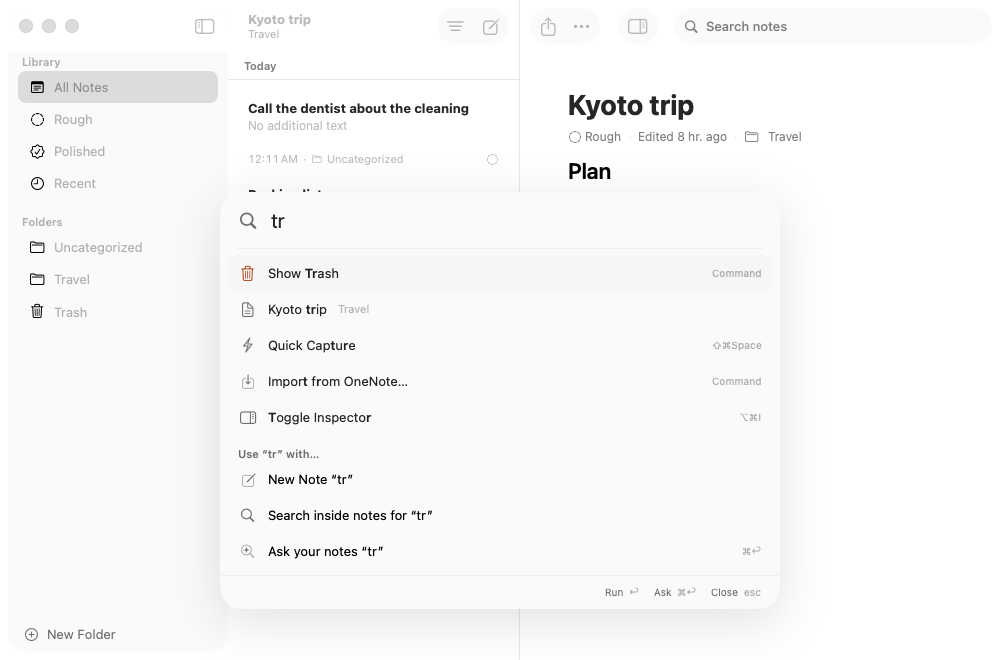
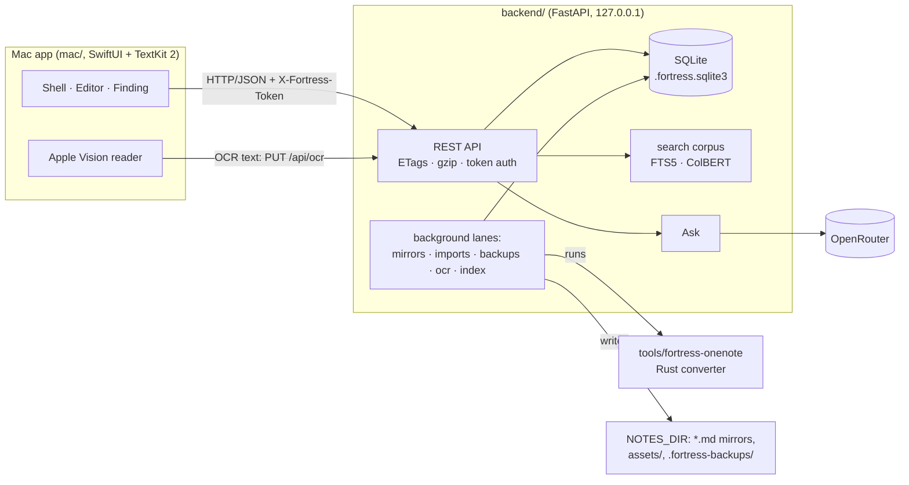

# Fortress Notes

A fast, local notes app for the Mac. A native macOS app (`mac/`, SwiftUI + TextKit 2,
Liquid Glass on macOS 26) over a local Python backend (`backend/`, FastAPI + SQLite).
Your notes live in one SQLite database on your Mac; every note is also mirrored to a
plain Markdown file, and the notes folder opens as an Obsidian vault. Fortress uses
open standards (CommonMark, GFM, Obsidian Markdown, YAML front matter) rather than
formats of its own: [docs/open-standards.md](docs/open-standards.md).

<p align="center">
  
</p>

- **Native Mac UI.** Sidebar with nested folders, a date-grouped note list, a TextKit 2
  block editor (checklists, lists, links, highlights, tables, columns, math, pictures,
  files), an inspector, a ⇧⌘O command palette and a global Quick Capture panel.
- **One search box.** Exact words (SQLite FTS5), meaning (ColBERT late interaction) and
  note titles in one ranked list. Each result shows the matching passage and opens the
  note at that paragraph.
- **Instant related notes.** The inspector shows notes related to the one you're reading
  and "Seen before" passages like the paragraph you're writing.
- **Ask your notes.** A question gets a short answer in about a second or two, with every
  sentence citing the paragraph it came from. Only the matching passages go to the
  model.
- **Text in every picture and PDF.** Pasted, imported and attached pictures and PDFs are
  read in the background, locally, so search, related notes and Ask find their text.
- **Lossless OneNote migration.** Exported notebooks become folders and notes, with
  tables, columns, pictures, attachments, ink, equations and links between pages.
  Every note and block records where it came from, and importing the same export
  again updates the notes in place and keeps your edits.

## Screenshots

<table>
  <tr>
    <td><br><sub>A note: checklist, lists, links, highlight</sub></td>
    <td><br><sub>An imported OneNote-style page: table, columns, sub/superscript</sub></td>
  </tr>
  <tr>
    <td><br><sub>Ask: every sentence cites its source</sub></td>
    <td><br><sub>⇧⌘O command palette: jump to a note or run a command</sub></td>
  </tr>
  <tr>
    <td><br><sub>Inspector › Text in pictures (Apple Vision, incl. Russian)</sub></td>
    <td><br><sub>OneNote import report</sub></td>
  </tr>
</table>

## Features

**Writing and organizing**
- Block editor with Markdown shortcuts; headings, bulleted/numbered/check lists, quotes,
  callouts, code, dividers, tables, columns, math, pictures and file attachments.
  Paste or drop a picture or file to attach it.
- Blocks you can see and move, Craft/Notion style, on a calm page: hover a block for its
  **⠿ handle** (drag to move it with its children, between blocks, nested, into a column,
  beside a block to make columns, into a table cell; click for **Turn Into**, Duplicate,
  Delete, **Copy Link to Block** as `[[Note#^id]]`, Move Up/Down, Info) and a **+** that
  adds a block. Type **`/`** at the start of a line for the insert menu (headings, lists,
  quote, callout, code, divider, `table 4x5`, 2/3 columns, image, file, math, note link).
  **Esc** selects blocks: ⇧↑/⇧↓ extend, ⌥⇧↑/⌥⇧↓ move, ⌘C/⌘X/⌫/Tab/⌘D act on them.
  View ▸ **Show Blocks** (⌥⌘B) keeps faint outlines and handles on every block. Every
  action is one named undo step and saves as ordinary block operations.
- Links to notes (type `[[` to pick one) and references to individual paragraphs,
  with backlinks in the inspector. Links always show the target's current title or text.
- Nested folders (drag notes and folders to move them), a **Rough / Polished** status
  per note, and a title that follows the first line until you set one.
- **Quick Capture** (⇧⌘Space, from any app) saves a thought to the *Uncategorized*
  folder; captures made while the backend is down wait on disk and are sent later.
- **Trash** with Undo, and **backups**: one SQLite snapshot per day (last 7 kept),
  manual snapshots, and restore from any of them (the current state is saved first).
- Markdown in and out: import `.md` files (⇧⌘I), export a note as Markdown (⇧⌘E).

**Finding**
- Unified search: FTS5 words, ColBERT meaning (`lightonai/Agent-ModernColBERT` via
  [PyLate](https://github.com/lightonai/pylate)) and titles fused with reciprocal rank
  fusion. Without the model, search and related notes fall back to keyword matching.
- Inspector: *Seen before*, *Related notes*, *Backlinks*, *Info* (dates, counts,
  provenance, re-import conflicts) and *Text in pictures*.
- ⇧⌘O palette (Open Quickly…): jump to a note by title, run any command, `?` to ask.

**Ask your notes**

How to ask:
- Click **Ask** in the toolbar (next to the search field) or press **⇧⌘A**
  (View › Ask Your Notes…), type your question, press Return. Any text already in the
  search field is filled in.
- Or type a question into the search field (placeholder "Search or ask a question") and
  press Return. Text that ends in `?`, or starts with who / what / when / where / why /
  how / which / is / are / can / do / does / did / should / could / would / will, puts
  the "Ask your notes" row first, so Return asks; anything else searches, and Return
  opens the top result.
- ⌘↩ in the search field always asks; `?` in the ⇧⌘O palette asks too.
- Without `OPENROUTER_API_KEY` in `backend/.env`, Ask says how to add it (and shows the
  closest passages) instead of failing; `GET /api/health` reports `ask_configured`.

How it works:
- Gathers candidate passages locally first (literal grep for the question's key words
  plus unified search), then one streamed model call answers, or asks for one more grep
  or a whole note within a 3-second budget. A sentence whose quote isn't really in the
  cited passage is dropped.
- Runs over [OpenRouter](https://openrouter.ai); default model `anthropic/claude-haiku-5.5`
  (`ASK_MODEL`). Needs `OPENROUTER_API_KEY`.

**Text in pictures and PDFs**
- The backend reads every picture and PDF once per content hash with RapidOCR
  (PaddleOCR PP-OCRv6 small, ONNX on the CPU; models ship in the wheel). PDFs use their
  text layer; only pages without one are OCR'd.
- The Mac app also reads them with Apple Vision (more scripts, handwriting) and sends
  the text to the backend, which prefers it. Toggle it in Settings › General ›
  *Text in Pictures*.

## Getting started

Requirements: macOS 26 with Xcode 26 (Swift 6.2 or later), [uv](https://docs.astral.sh/uv/)
(Python 3.11+), and Rust (stable) if you want to import OneNote.

**Quick start:** `./start.sh` installs the backend's dependencies, creates `backend/.env`
if it's missing, builds the OneNote converter when Rust is installed, then builds and
opens the Mac app, which starts and stops the backend itself. `./start.sh --backend`
runs only the backend at `http://127.0.0.1:8000`, for development. The steps below are
what it does.

### 1. Backend

```bash
cd backend
uv sync --frozen             # creates backend/.venv with exactly the locked dependencies
cp .env.example .env         # then set OPENROUTER_API_KEY in backend/.env
```

Put your OpenRouter key in `backend/.env` (it is gitignored); never put it in a
committed file. Without a key everything works except Ask.

On first start the background indexer downloads `lightonai/Agent-ModernColBERT` (at the
commit pinned in `backend/app/config.py`) from Hugging Face; until it has loaded, search and related notes use keyword matching. Set
`EMBEDDINGS_ENABLED=false` to skip the model.

### 2. Mac app

```bash
cd mac
swift build
swift run FortressNotes
```

You don't start the backend yourself. The app finds the repository it was built in
(Settings › General › *Folder*; it walks up from the executable to the folder holding
`backend/app/main.py`) and, with *Start the backend automatically* on (the default),
starts it at launch and stops it when you quit:

- command: `backend/.venv/bin/uvicorn app.main:app --port <port>` if the virtualenv
  exists, otherwise `uv run --frozen uvicorn app.main:app --port <port>`, run in `backend/`;
- port: the one in Settings (default `http://127.0.0.1:8000`), or a free one if that is
  taken;
- environment: a fresh random `FORTRESS_TOKEN` per launch (every request must carry it,
  see `backend/app/auth.py`), `FORTRESS_PARENT_PID` (the backend exits if the app dies)
  and `FORTRESS_ONENOTE_BIN` when the converter is built;
- log: `~/Library/Logs/Fortress Notes/backend.log` (Settings › *Show Log*).

To run the backend by hand instead, turn off *Start the backend automatically* and
point Settings at its address:

```bash
cd backend
uv run --frozen uvicorn app.main:app --port 8000
```

Without `FORTRESS_TOKEN` the backend accepts loopback requests only, and refuses
browser requests either way.

### 3. OneNote converter (optional)

```bash
cd tools/fortress-onenote
cargo build --release --locked   # -> target/release/fortress-onenote
```

The app passes the built binary to the backend it starts. CI also builds a universal
macOS binary (artifact `fortress-onenote-macos-universal`).

## Importing from OneNote

No Microsoft sign-in is involved: you export the notebooks as files and import those.

1. In a browser, open **onenote.com/notebooks**, right-click a notebook and choose
   **Export notebook**. A `.zip` downloads. If there is no *Export notebook* item, open
   **onedrive.com**, select the notebook (or the folder holding your notebooks) and click
   **Download**. On Windows, OneNote's *File › Export › Notebook › OneNote Package*
   (`.onepkg`) works too.
2. Unlock password-protected sections in OneNote before exporting; locked sections are
   skipped and listed in the report.
3. In Fortress: **File › Import › From OneNote…** (or ⇧⌘O "Import from OneNote…"), drop
   the `.zip`, `.onepkg` or `.one` file, and choose where the notebooks go.

Notebooks, section groups and sections become folders; pages become notes (subpages
stay next to their parent, which gets a *Subpages* list). The report lists counts per
notebook, sections that failed, pages whose text coverage is below 98 %, links that
couldn't be resolved, and pages removed in OneNote since the last import (never deleted
here). Importing the same export again updates the notes in place and keeps your edits;
where both sides changed a paragraph, the inspector shows the conflict.

Details: [spec.md §7b](spec.md#7b-onenote-import-onenote_importpy) and
[docs/onenote-import.md](docs/onenote-import.md).

## Configuration

Settings are read once from the environment and `backend/.env` (always that file,
whatever the current directory; environment variables win). Relative paths are
relative to `backend/`. See [`backend/.env.example`](backend/.env.example).

| Variable | Default | Meaning |
| --- | --- | --- |
| `NOTES_DIR` | `../notes` | Folder for the database, Markdown mirrors, pictures, backups and the embedding index |
| `OPENROUTER_API_KEY` | — | Needed for Ask |
| `ASK_MODEL` | `anthropic/claude-haiku-5.5` | OpenRouter model Ask uses |
| `ASK_REASONING_EFFORT` | `none` | OpenRouter reasoning effort for `ASK_MODEL` (empty: the model's default) |
| `OPENROUTER_MODEL` | `anthropic/claude-haiku-5.5` | Fallback model for LLM calls that name none (Ask always names `ASK_MODEL`) |
| `EMBEDDINGS_ENABLED` | `true` | ColBERT search and related notes (off: keyword matching) |
| `COLBERT_MODEL` | `lightonai/Agent-ModernColBERT` | Late-interaction model |
| `COLBERT_REVISION` | pinned commit | Commit of the model's Hugging Face repository (default: the one in `app/config.py` for the default model; see [docs/dependencies.md](docs/dependencies.md)) |
| `EMBEDDINGS_PRECISION` | `auto` | `auto` (bfloat16 where the CPU supports it), `float32` or `bfloat16` |
| `EMBEDDINGS_THREADS` | `0` | Torch threads (0 = half the cores, at most 4) |
| `REINDEX_INTERVAL_S` | `5` | How often changed paragraphs are re-encoded |
| `VISION_ENABLED` | `true` | The backend's own OCR of pictures and PDFs |
| `OCR_THREADS` | `0` | ONNX Runtime threads for OCR (0 = half the cores, at most 4) |
| `AUTO_BACKUP_ENABLED` | `true` | Daily snapshot in `NOTES_DIR/.fortress-backups` |
| `FORTRESS_ONENOTE_BIN` | — | The converter binary (else the repository build, next to Python, `../Resources/bin`, or `PATH`) |
| `FORTRESS_ONENOTE_TIMEOUT_S` | `3600` | Seconds before a conversion is stopped |

Read from the process environment only (not from `.env`): `FORTRESS_TOKEN`,
`FORTRESS_PARENT_PID` (both set by the app) and `FORTRESS_ALLOWED_HOSTS` (extra `Host`
names accepted without a token).

## Architecture



- **SQLite is the only source of truth** (`NOTES_DIR/.fortress.sqlite3`): folders,
  documents, nested blocks with stable ids, links, history, assets, OCR text, FTS5. The
  block model is the contract between backend and clients:
  [docs/block-model.md](docs/block-model.md). Edits are revision-checked block
  transactions; each is one undo step.
- **Background work** runs in one manager (`backend/app/background.py`), one thread per
  lane: Markdown mirrors (`NOTES_DIR/<folder>/<Title>.md`, an Obsidian vault, write-only), OneNote import jobs, daily
  backups, OCR and ColBERT indexing. Low-priority lanes yield while a search is scoring.
- **Search corpus** (`backend/app/corpus.py`): the searchable text of every paragraph,
  updated by deltas from SQLite's change log; search, related notes, Ask's grep and the
  indexer all read it. Embeddings persist in `NOTES_DIR/.fortress-embeddings.sqlite3`.
- **Local auth** (`backend/app/auth.py`): browser requests are refused; with
  `FORTRESS_TOKEN` set every request needs it.
- **OneNote**: the Rust converter turns an export into `manifest.json` + content-addressed
  assets; `backend/app/onenote_import.py` imports it as living documents.

## Development

| Component | Run tests | CI workflow |
| --- | --- | --- |
| Backend | `cd backend && uv run --frozen python -m unittest discover -s tests` | [`backend.yml`](.github/workflows/backend.yml): unit tests on Python 3.13, offline (no model download, no LLM key) |
| Mac app | `cd mac && swift build && swift test` | [`mac.yml`](.github/workflows/mac.yml): build, tests and window snapshots (artifact `snapshots`), editor and finding performance, and integration tests against a real backend seeded by `mac/Scripts/seed_backend.py` |
| OneNote converter | `cd tools/fortress-onenote && cargo fmt --check && cargo clippy --all-targets --locked -- -D warnings && cargo test --locked` | [`onenote-tool.yml`](.github/workflows/onenote-tool.yml): Linux tests, plus a universal macOS binary |
| Dependency cooldown | `python3 .github/scripts/check_cooldown.py` | [`dependencies.yml`](.github/workflows/dependencies.yml): every pin released at least 7 days before it was pinned ([docs/dependencies.md](docs/dependencies.md)) |

Mac test switches: `SNAPSHOT_DIR=<dir>` writes window snapshots there,
`FINDING_PERF=1` enables the finding performance suite, and
`FORTRESS_INTEGRATION_URL=http://127.0.0.1:8000` (with the backend's `FORTRESS_TOKEN`
in the environment) runs `IntegrationTests`.

[`tools/onenote-compare`](tools/onenote-compare/README.md) checks the OneNote importer
page by page against an independent rendering (one2html) and writes an HTML report.

Benchmarks and calibration scripts live in `backend/scripts/` (`bench.py`,
`bench_api.py`, `bench_workspace.py`, `calibrate_related.py`).

## Project layout

```
backend/
  app/                FastAPI app: main.py (routes), block_store.py, block_schema.py,
                      documents.py, sources.py, search.py, corpus.py, embeddings.py,
                      ask.py, llm.py, ocr.py, onenote_import.py, background.py, auth.py, ...
  tests/              unittest suite
  scripts/            benchmarks and calibration
  .env.example        configuration template (copy to .env)
mac/
  Package.swift       SwiftPM: FortressKit library + FortressNotes executable (macOS 26)
  Sources/FortressKit/
    API/              client, auth token, caches
    App/              AppModel
    Shell/            window, sidebar, note list, settings, backend launcher, imports, backups, trash
    Editor/           TextKit 2 block editor (Model/, Text/)
    Finding/          search, Ask, palette, inspector, Quick Capture, Apple Vision reader
  Tests/              unit, snapshot, performance and integration tests
  Scripts/            seed_backend.py (integration seeding), fixture regeneration
tools/
  fortress-onenote/   Rust OneNote converter (manifest format: SCHEMA.md)
  onenote-compare/    importer verification against one2html
docs/                 block model, OneNote research, screenshots
notes/                default NOTES_DIR (gitignored except the welcome note)
spec.md               backend spec: data model, API, OCR, provenance, OneNote import
```

## Documentation

- [spec.md](spec.md): data model, API, caching, search, OCR, backups, provenance and
  living documents, OneNote import jobs.
- [docs/block-model.md](docs/block-model.md): the block model contract (types, inline
  content, transactions, Markdown form).
- [docs/open-standards.md](docs/open-standards.md): the open-standards policy and the
  decision for every format Fortress reads or writes.
- [docs/dependencies.md](docs/dependencies.md): the dependency policy (exact pins,
  7-day cooldown enforced in CI) and how to update each kind of dependency.
- [mac/DESIGN.md](mac/DESIGN.md): the Mac app's design system and screen-by-screen spec.
- [docs/onenote-import.md](docs/onenote-import.md): OneNote migration research and design.
- [tools/fortress-onenote/README.md](tools/fortress-onenote/README.md) and
  [SCHEMA.md](tools/fortress-onenote/SCHEMA.md): the converter and its manifest.
- [tools/onenote-compare/README.md](tools/onenote-compare/README.md): visual
  verification of imports.
