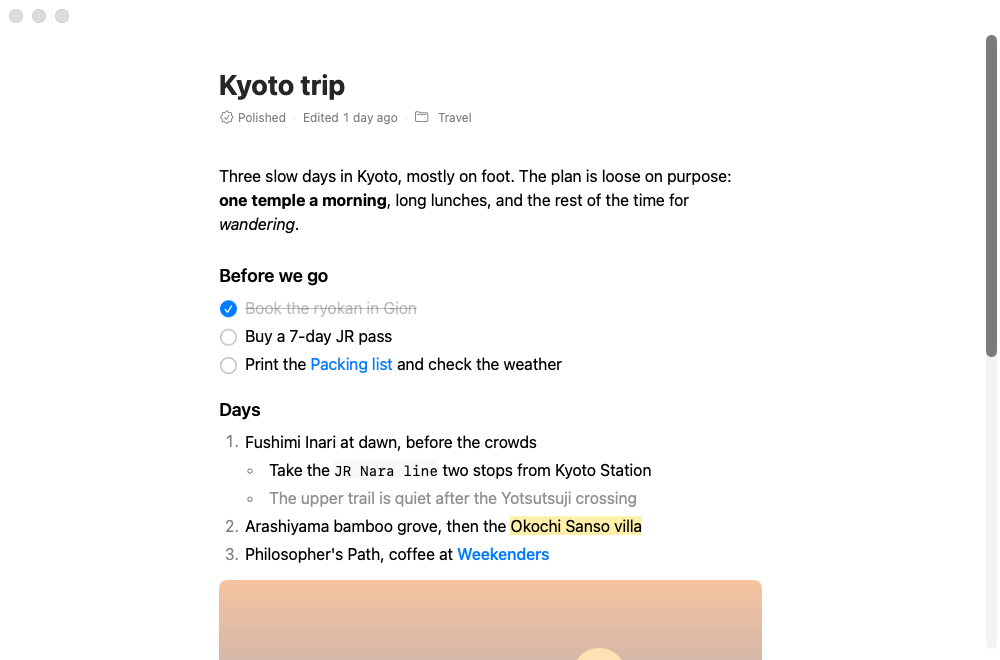
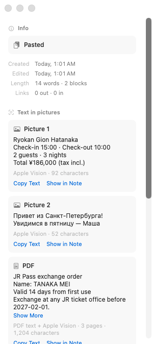
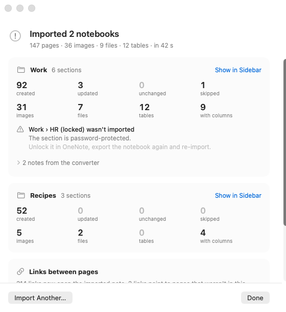

# Fortress Notes

A fast, local notes app for the Mac: a native macOS app (`mac/`, SwiftUI + TextKit 2,
macOS 26) over a local Python backend (`backend/`, FastAPI + SQLite). Your notes live
in one SQLite database on your Mac; every note is also written, one way, to a plain
Markdown file, so the notes folder opens as an Obsidian vault.

<p align="center">
  
</p>

- **A native block editor.** Headings, lists, checklists, quotes, callouts, code,
  tables, columns, pictures and files, with Markdown shortcuts. Hover a block for its
  ⠿ handle (drag to move; click for Turn Into, Duplicate, Delete, Copy Link to
  Block), type `/` for the insert menu, press Esc to select blocks. Links to notes
  (`[[`) and to single paragraphs always show the target's current title or text.
- **One search box.** Exact words (SQLite FTS5), meaning (ColBERT) and titles in one
  ranked list; each result opens the note at that paragraph.
- **Related notes as you write.** The inspector shows notes like the one you're
  reading and "Seen before" passages like the paragraph you're writing, plus
  backlinks, info and the text read from the note's pictures.
- **Ask your notes.** A question gets a short answer in a second or two, every
  sentence citing the paragraph it came from. Only the matching passages go to the
  model (via OpenRouter).
- **Text in every picture and PDF**, read locally in the background (RapidOCR in the
  backend, Apple Vision in the app), so search and Ask find it.
- **Pictures found by what they show** (optional, Settings › General): a small local
  model describes each picture in a few words, so "dog on the beach" finds the photo
  ([docs/picture-descriptions.md](docs/picture-descriptions.md)).
- **OneNote import**, by download from Microsoft or from a `.onepkg` file. Re-importing
  refreshes changed pages in place and never overwrites pages you edited here.
- **Quick Capture** (⇧⌘Space from any app), nested folders, Trash with Undo, daily
  backups, Markdown import and export.

## Screenshots

<table>
  <tr>
    <td><br><sub>A note: checklist, lists, links, highlight</sub></td>
    <td><br><sub>An imported OneNote-style page: table, columns, sub/superscript</sub></td>
  </tr>
  <tr>
    <td><br><sub>Ask: every sentence cites its source</sub></td>
    <td><br><sub>Inspector › Text in pictures</sub></td>
  </tr>
  <tr>
    <td colspan="2"><br><sub>OneNote import report</sub></td>
  </tr>
</table>

## Quick start

Requirements: macOS 26 with Xcode 26, [uv](https://docs.astral.sh/uv/), and Rust
(stable) only if you want to import `.onepkg` files.

```bash
./start.sh             # set up the backend, build and open the Mac app
./start.sh --backend   # only the backend, at http://127.0.0.1:8000 (development)
```

`start.sh` installs the backend's locked dependencies, creates `backend/.env` from
`.env.example` if it's missing (put `OPENROUTER_API_KEY` there for Ask; never commit
it), builds the OneNote converter when Rust is installed, then builds and opens the
app. The app starts the backend itself with a fresh access token and stops it when you
quit (Settings › General shows its status, command and log). On first start the
ColBERT model is downloaded from Hugging Face; until it has loaded, search uses
keyword matching.

**Older notes database?** If the app says the database is at an older schema
version, quit Fortress and run `./upgrade-database.sh` once. It keeps a copy of the
database next to it and upgrades it with the last release that still migrates.

## Importing from OneNote

**File › Import › From OneNote…** offers two ways (OneNote for the web no longer
exports notebooks, and OneNote for Mac only saves PDFs):

- **Download from Microsoft** (default, no Terminal). Enter the *Application (client)
  ID* of a free app you register once in Microsoft Entra (about five minutes; the
  sheet lists the steps), pick a personal or work account, optionally choose
  notebooks, and press **Download and Import**. You sign in in your browser
  (read-only), the sheet shows progress and imports the result. Microsoft allows
  about 400 requests an hour, so a large first download takes a while; you can stop
  or quit at any time and running it again continues, fetching only changed pages
  later. The backend runs [`tools/fortress-onenote-graph`](tools/fortress-onenote-graph/README.md)
  for this (it needs uv). Graph loses custom note tags and section order.
- **Import a file** (most complete). On Windows, OneNote's *File › Export › Notebook
  › OneNote Package (.onepkg)*, or a section as `.one`; unlock protected sections
  first. Drop the file on the sheet. A `.zip` from an earlier download works too.

Notebooks, section groups and sections become folders and pages become notes. The
report lists counts, failed sections, pages whose text coverage is below 98 %,
unresolved links and pages removed in OneNote (never deleted here). Fortress has no
math or ink: equations are kept as plain text, ink is skipped and counted. Decisions:
[docs/onenote-import.md](docs/onenote-import.md).

## Configuration

Read once from the environment and `backend/.env` (environment variables win;
relative paths are relative to `backend/`). Template:
[`backend/.env.example`](backend/.env.example).

| Variable | Default | Meaning |
| --- | --- | --- |
| `NOTES_DIR` | `../notes` | Database, Markdown mirror, pictures, backups and embedding index |
| `OPENROUTER_API_KEY` | — | Needed for Ask |
| `ASK_MODEL` | `anthropic/claude-haiku-5.5` | OpenRouter model for Ask |
| `ASK_REASONING_EFFORT` | `none` | Reasoning effort for `ASK_MODEL` (empty: the model's default) |
| `EMBEDDINGS_ENABLED` | `true` | ColBERT search and related notes (off: keyword matching) |
| `COLBERT_MODEL` | `lightonai/Agent-ModernColBERT` | Late-interaction model |
| `COLBERT_REVISION` | pinned commit | Model repository commit ([docs/dependencies.md](docs/dependencies.md)) |
| `EMBEDDINGS_DEVICE` | `auto` | `auto` (MLX on Apple Silicon when installed, else CPU), `mlx` or `cpu` |
| `EMBEDDINGS_THREADS` | `0` | Torch threads (0 = half the cores, at most 4) |
| `PRECOMPUTE_QUERY_EMBEDDINGS` | `true` | Precompute each paragraph's query encoding for "Seen before" |
| `REINDEX_INTERVAL_S` | `5` | How often changed paragraphs are re-encoded |
| `VISION_ENABLED` | `true` | The backend's own OCR of pictures and PDFs |
| `OCR_THREADS` | `0` | OCR threads (0 = half the cores, at most 4) |
| `PICTURE_DESCRIPTIONS` | `false` | Describe pictures with a local model (the Mac app's Settings switch turns it on too) |
| `WELCOME_NOTE` | `true` | A new workspace starts with the Welcome note |
| `AUTO_BACKUP_ENABLED` | `true` | Daily snapshot in `NOTES_DIR/.fortress-backups` (last 7 kept) |
| `FORTRESS_ONENOTE_BIN` | — | The converter binary (else the repository build, next to Python, or `PATH`) |
| `FORTRESS_ONENOTE_TIMEOUT_S` | `3600` | Seconds before a conversion is stopped |
| `FORTRESS_ONENOTE_GRAPH_DIR` | — | The download tool's folder (else `tools/fortress-onenote-graph`) |

The app sets `FORTRESS_TOKEN` and `FORTRESS_PARENT_PID` in the backend's
environment; `FORTRESS_ALLOWED_HOSTS` adds `Host` names accepted without a token.

## Architecture

```
Mac app ──HTTP + per-launch token──▶ backend (FastAPI on 127.0.0.1) ──▶ SQLite
   └─ Apple Vision text ─▶ PUT /api/ocr     ├─ background lanes: mirror · imports · downloads · backups · OCR · index · captions
                                            ├─ Ask ──▶ OpenRouter (matching passages only)
                                            └─ runs tools/fortress-onenote (Rust), tools/fortress-onenote-graph
```

SQLite is the only source of truth; edits are revision-checked block transactions
against the contract in [docs/block-model.md](docs/block-model.md). Undo is the
editor's own, per note, and saves as ordinary edits. Background work (the Markdown
mirror, imports, downloads, backups, OCR, indexing) runs on lanes that yield to
search. The backend refuses browser requests and, with a token set, any request
without it.

## FAQ

### Why a block database instead of Markdown files in git?

Markdown files with git commits is a sound design (Obsidian works that way).
Fortress stores blocks in SQLite because related notes, block links and Ask citations
need every paragraph to have a stable identity. It still writes every note out as
Markdown, so you can always leave.

| | Blocks in SQLite (Fortress) | Markdown + git as the source of truth |
|---|---|---|
| **Paragraph links** | Every block has a stable id; links survive edits, renames, moves and re-imports | Ids live in the text (`^abc123`); an edit elsewhere can drop or duplicate them |
| **Search and related notes** | The index re-encodes only the paragraphs that changed (SQLite's change log) | Each save re-parses the file and guesses which paragraphs are new |
| **Concurrent edits** | Each save is checked against the note's revision; a stale one is refused and the editor offers to load the latest | Git merges by line; a paragraph is one line, so edits conflict or the last write wins |
| **Undo** | Per note in the editor, named steps; no server history | Editor-local; history per commit |
| **Rich content** | Tables whose cells hold blocks, columns, callouts and OneNote layout kept | No faithful Markdown form |
| **Pictures** | Stored once by content hash, with cached OCR text | The repository grows unless you add Git LFS |
| **Open format** | ✅ The Markdown mirror is an Obsidian vault | ✅ natively |
| **Edit with any editor** | ⚠️ The mirror is write-only: overwritten when the note changes, never read back | ✅ |
| **Where a note came from** | Per note (manual, capture, import); not per block | Whatever you write in front matter |
| **History** | Daily database snapshots (last 7); no per-note history | ✅ free with git |
| **Sync** | Not built in (one Mac) | ✅ any git remote |
| **Simplicity** | A server process and a database | Just files |

## Tests

| Component | Run | CI |
| --- | --- | --- |
| Backend | `cd backend && uv run --frozen python -m unittest discover -s tests` | [`backend.yml`](.github/workflows/backend.yml) |
| Mac app | `cd mac && swift build && swift test` | [`mac.yml`](.github/workflows/mac.yml): tests, window snapshots, performance, integration against a real backend |
| OneNote converter | `cd tools/fortress-onenote && cargo test --locked` | [`onenote-tool.yml`](.github/workflows/onenote-tool.yml) |
| OneNote download tool | `cd tools/fortress-onenote-graph && uv run --frozen python -m unittest discover -s tests -t .` | [`onenote-graph.yml`](.github/workflows/onenote-graph.yml) |
| Dependency cooldown | `python3 .github/scripts/check_cooldown.py` | [`dependencies.yml`](.github/workflows/dependencies.yml) |

## Documentation

- [spec.md](spec.md): what the app does and the invariants it keeps.
- [docs/block-model.md](docs/block-model.md): the block model contract (types,
  inline content, transactions, Markdown form, schema policy).
- [docs/open-standards.md](docs/open-standards.md): the open-standards policy and
  every format decision.
- [docs/onenote-import.md](docs/onenote-import.md): OneNote import decisions.
- [docs/dependencies.md](docs/dependencies.md): exact pins, the 7-day cooldown, how
  to update.
- [docs/picture-descriptions.md](docs/picture-descriptions.md): the optional picture
  descriptions: the models compared, the numbers, the choice.
- [mac/DESIGN.md](mac/DESIGN.md): the Mac app's design: principles, shortcuts,
  interaction rules, theming.
- [tools/fortress-onenote/README.md](tools/fortress-onenote/README.md) and
  [SCHEMA.md](tools/fortress-onenote/SCHEMA.md): the converter and its manifest.
